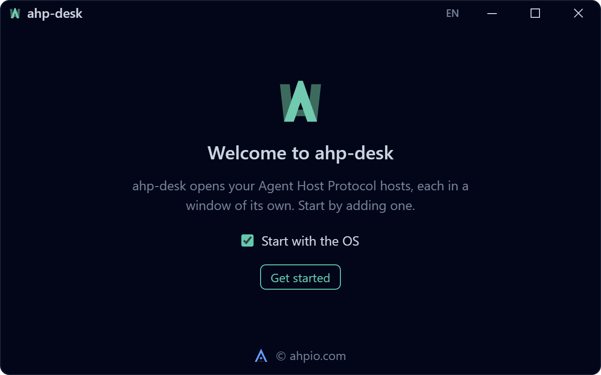
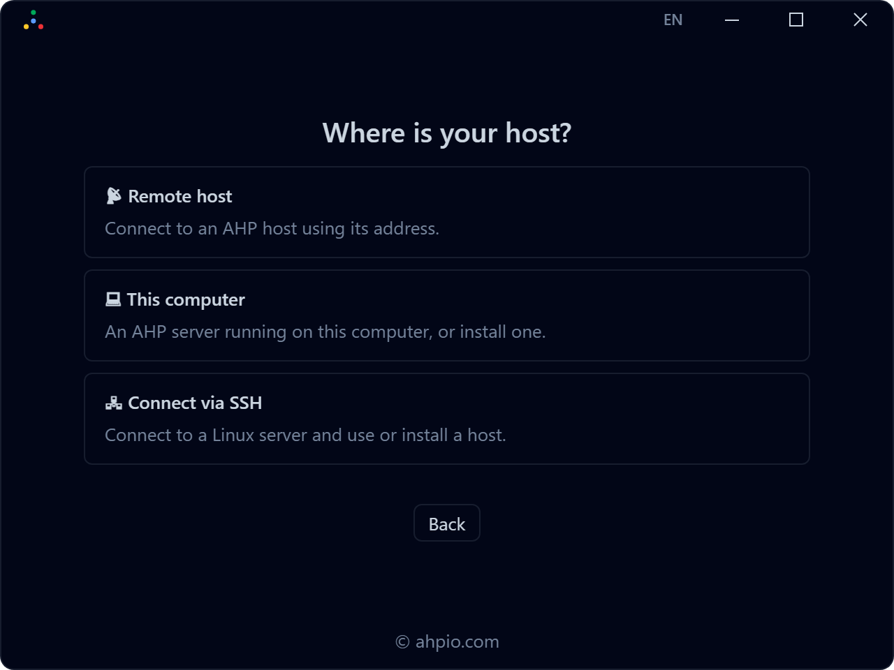
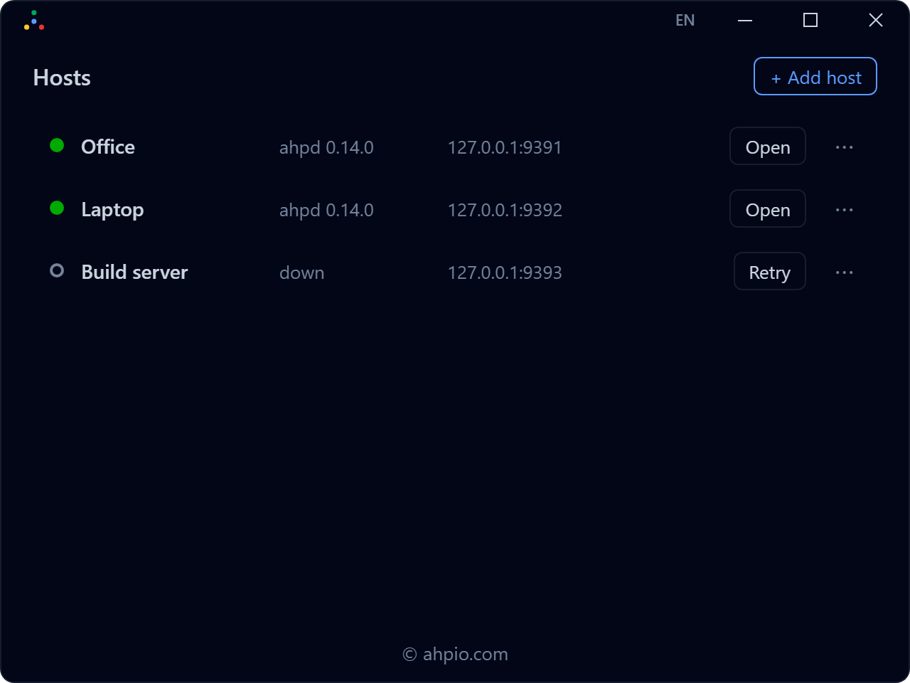
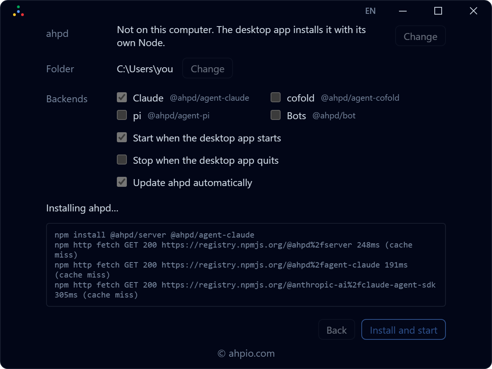
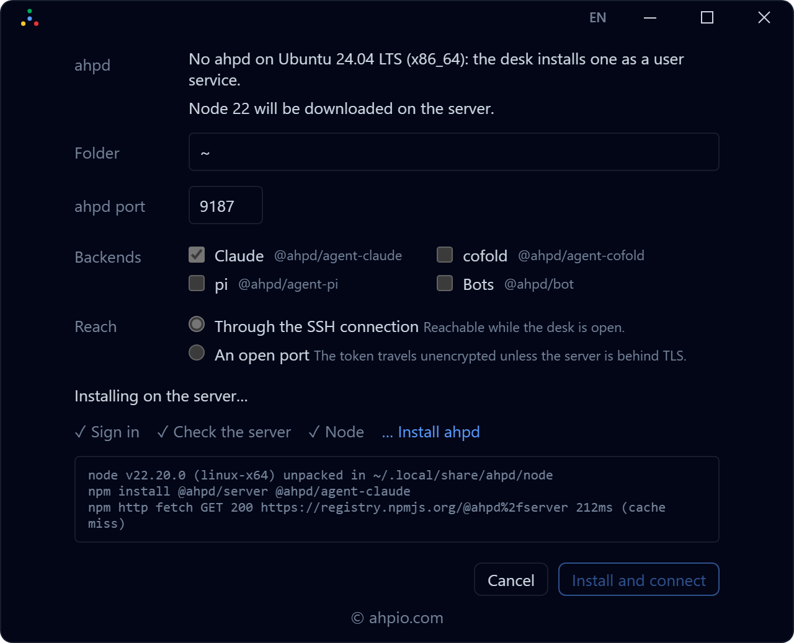
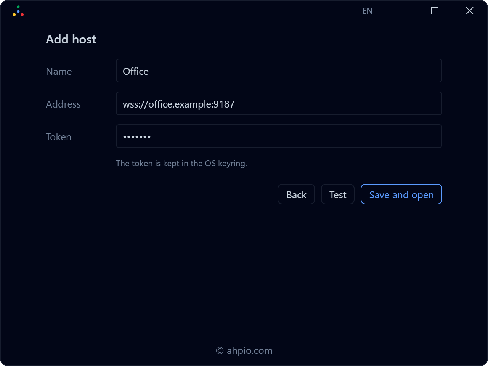
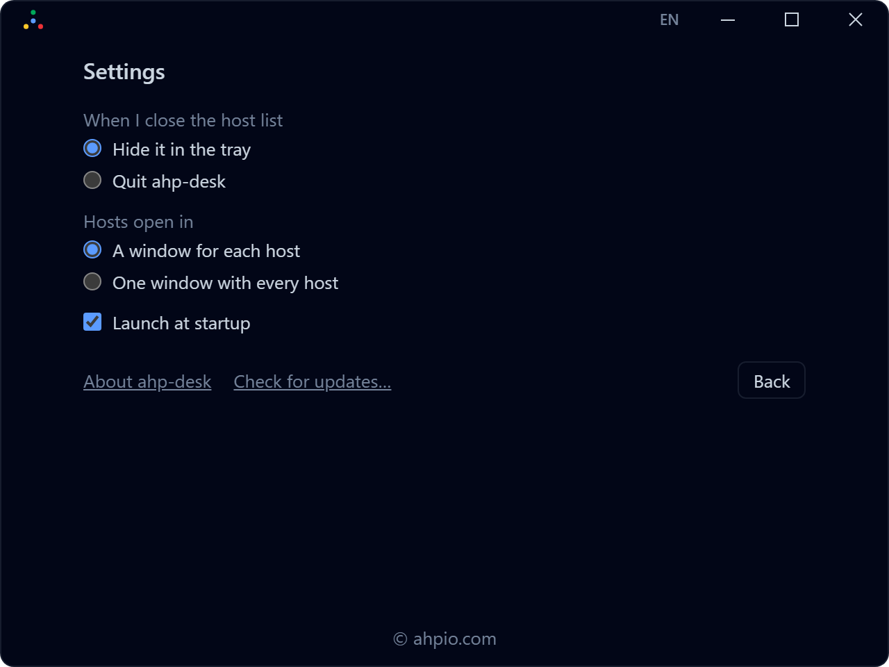

#  ahp-desk

[](https://github.com/softov/ahp-desk/releases/latest)


A desktop app for [Agent Host Protocol](https://microsoft.github.io/agent-host-protocol/) hosts, on Windows and Linux.

Keep a list of your hosts, see which ones are up, and open each one in a window of its own with [ahpw](https://github.com/softov/ahpw).



---

## What it does

- **🖥️ Manage multiple hosts**: Keep all your AHP hosts in one place, with live connection status, server names, and versions.
- **➕ Connect your way**: Use a local host, connect to a Linux server over SSH, or add any existing AHP host by address.
  See [Add your first host](#add-your-first-host).
- **⚙️ Install and configure [ahpd](https://softov.github.io/ahpd/)**: Set up local or remote hosts, choose agent backends, and manage their lifecycle.
- **🗂️ Work across hosts**: Open each host in a dedicated window, or access them all from a single window using ahpw.
- **🔄 Stay up to date**: Update `ahp-desk` and managed ahpd installations, with control over when restarts happen.
- **📌 Always accessible**: Keep `ahp-desk` in the system tray and optionally launch it when you sign in.
- **🌍 Multilingual**: Available in English, Portuguese, and Spanish.

---

## Install

Download the latest version of `ahp-desk` from [GitHub Releases](https://github.com/softov/ahp-desk/releases/latest).

### Windows 10 / 11

Download `ahp-desk_<version>_x64-setup.exe` and run the installer.
Installation is per-user and requires no administrator privileges.

> **Note:** The installer is not yet code-signed.
> If Windows SmartScreen displays a warning, select **More info → Run anyway**.

### Linux

Choose the package that works best for your distribution.

**AppImage: most Linux distributions**

Download `ahp-desk_<version>_amd64.AppImage`, make it executable, and run it.

```bash
chmod +x ahp-desk_*.AppImage
./ahp-desk_*.AppImage
```

**Debian / Ubuntu**

Download `ahp-desk_<version>_amd64.deb` and install it with:

```bash
sudo apt install ./ahp-desk_*.deb
```

**System tray:** `ahp-desk` uses `libayatana-appindicator3`, bundled with the AppImage and installed automatically by the Debian package.
GNOME also requires the AppIndicator extension (`gnome-shell-extension-appindicator`).

Without system tray support, closing the host list exits `ahp-desk`.

### Automatic updates

`ahp-desk` checks for new releases automatically, so you don't need to download and install each update manually.
Every update is cryptographically verified before installation.


## Add your first host

`ahp-desk` guides you through connecting to your first host.
Choose where your agents run, and the desk handles the connection and setup.





### This computer

Run your agents directly on your computer.

`ahp-desk` detects existing ahpd installations or sets up a new one, including its own Node.js runtime.
Choose your agent backends and workspace, then let the desk manage starting, stopping, and updating the host.



### Connect via SSH

Set up or manage ahpd on a remote Linux server.

`ahp-desk` connects over SSH, checks the server environment, and detects existing installations.
It can install ahpd as a user service and connect through SSH or a directly accessible port.



### Remote host

Connect to any existing AHP-compatible server.

Enter the host address, name, and authentication token.
Test the connection before saving it to your host list.




## Using it

**Open** on a host shows it in its own window.
Close the host list and the desk stays in the tray; its menu, or on Windows a click on its icon, brings the list back.

The logo at the top left opens the menu: Hosts, Add host, Settings, Check for updates…, About ahp-desk and Quit.
Check for updates and About open in small windows of their own, so the host list keeps what it shows.

**Settings** has:

- **When I close the host list**: hide it in the tray, or quit ahp-desk.
- **Launch at startup**.
- **Hosts open in**: a window for each host, or one window with every host.



**Updates:** when a newer desk is ready, the host list says so, and **Restart** installs it.
When a host runs an older ahpd, its row offers **Update**.
Both name the sessions still running before anything stops.

## Where it keeps things

- The host list and the settings: `%APPDATA%\dev.softov.ahpdesk\` on Windows, `~/.config/dev.softov.ahpdesk/` on Linux.
- Tokens and SSH passwords: the OS keyring (Windows Credential Manager, or the Secret Service on Linux), never in the host list.
- SSH server keys you trusted: `known_keys.json` beside the host list, and your own `~/.ssh/known_hosts` is read, never written.

## Build it yourself

See [DEVELOPER.md](DEVELOPER.md): the tools, building on Windows and Debian, testing ahpw from source, and how a release is made.

## Related

- [ahpd](https://github.com/softov/ahpd), an AHP server and daemon, with its [documentation](https://softov.github.io/ahpd/).
- [ahpw](https://github.com/softov/ahpw), the web UI the desk shows in each host's window.

## Open source. Built for your hosts.

`ahp-desk` is open source and released under the [MIT license](LICENSE).

Keep every host you work with in one place: this computer, your servers, and any AHP host you can reach.
Choose the agents each one runs, and open the ones you need, each in its own window.

Use it for a personal setup, a team that shares servers, or a fleet of hosts.

**Your hosts. Your agents. One desktop.**

`ahp-desk` is part of ahpio, the Agent Host Platform.
Get to know the whole platform at [ahpio.com](https://ahpio.com).

[Releases](https://github.com/softov/ahp-desk/releases/latest) · [Source Code](https://github.com/softov/ahp-desk) · [ahpio.com](https://ahpio.com)
